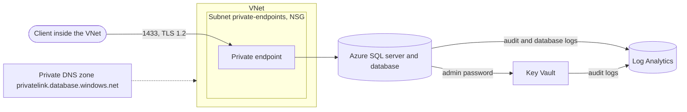

# Azure SQL Database

An Azure SQL Database on a logical SQL server, reachable only through a private endpoint. Basic SKU by default.

OpenTofu demo template. Standalone, no dependency on other repos. Compatible with Terraform. Needs OpenTofu 1.12.0 or newer (write-only password).

## Architecture



- Resource group, VNet with a subnet for the private endpoint and an NSG (port 1433 only from the VNet)
- Logical SQL server with public network access disabled, minimum TLS 1.2
- One database (Basic by default; Standard, General Purpose serverless or provisioned selectable)
- Private endpoint and private DNS zone `privatelink.database.windows.net` linked to the VNet
- Admin password generated per apply and stored in Key Vault
- Server auditing, database logs and Key Vault audit logs to Log Analytics

## Security

- Public network access disabled, access only through the private endpoint
- Minimum TLS 1.2, transparent data encryption on
- Admin password generated per apply as an ephemeral value and written only to write-only arguments. It is never in the state
- Password stored in Key Vault with RBAC, a 1-year expiry date and soft delete
- The identity that runs OpenTofu is the Entra ID admin of the server. SQL logins stay enabled for the admin password
- Point-in-time restore (1 to 35 days, Basic up to 7, default 7)
- Server auditing to Log Analytics, database error, timeout, block and deadlock logs, Key Vault audit logs

Accepted checkov findings (documented inline in the code):

| Check | Reason |
|---|---|
| CKV2_AZURE_2 | Vulnerability assessment needs Microsoft Defender for SQL, which is billed per server |
| CKV_AZURE_24 | Audit logs go to Log Analytics, retention is configurable (`advanced_settings.log_retention_days`) |
| CKV_AZURE_224 | Ledger is an application choice and cannot be turned off later |
| CKV_AZURE_229 | Zone redundancy is not available for Basic and Standard and is out of scope (cost) |
| CKV_AZURE_109, CKV_AZURE_189 | OpenTofu writes the secret from outside the VNet, access is controlled by RBAC |
| CKV2_AZURE_32 | Private endpoint for Key Vault is out of scope |
| CKV_AZURE_110, CKV_AZURE_42 | Purge protection would block re-deploying the demo for up to 90 days |

The Trivy scan (`trivy config`) accepts findings with `#trivy:ignore` comments above the resource. The reason is written in the same line.

## Usage

Sign in with `az login` and set `ARM_SUBSCRIPTION_ID` to the target subscription.

```bash
cp terraform.tfvars.example terraform.tfvars
tofu init
tofu plan
tofu apply
```

## Access

The server is reachable only from inside the VNet. There, its FQDN resolves to the private endpoint. Clients must run in this VNet or a peered network that uses the private DNS zone. Read the admin password from Key Vault:

```bash
az keyvault secret show --id "$(az keyvault show --ids <key_vault_id> --query properties.vaultUri -o tsv)secrets/sql-admin-password" --query value -o tsv
```

Connect with TLS, for example `sqlcmd -S <server_fqdn> -d <database_name> -U <administrator_login> -N`.

The identity that runs OpenTofu gets the role "Key Vault Secrets Officer" on the vault. To set a new password, increase `advanced_settings.password_version` and run `tofu apply`.

## Inputs

| Name | Description | Default |
|---|---|---|
| `name_prefix` | Prefix for all resource names | `"demo"` |
| `location` | Azure location | `"germanywestcentral"` |
| `advanced_settings` | Object with the settings below, all optional | `{}` |

`advanced_settings` attributes (shown as "Advanced Settings" in the StackGuardian form):

| Name | Description | Default |
|---|---|---|
| `vnet_cidr` | Address space of the VNet | `"10.0.0.0/16"` |
| `sku_name` | `Basic`, `S0`, `S1`, `S2`, `GP_S_Gen5_1`, `GP_S_Gen5_2` (serverless, pauses after 60 minutes idle), `GP_Gen5_2`, `GP_Gen5_4` | `"Basic"` |
| `max_size_gb` | Maximum database size in GB, Basic up to 2, others up to 250. Basic and Standard accept only fixed sizes (1, 2, 5, 10, 20, 30, 40, 50, 100, 150, 200, 250) | `2` |
| `database_name` | Name of the database | `"app"` |
| `administrator_login` | Admin user, reserved names like `admin` or `sa` are rejected | `"sqladmin"` |
| `password_version` | Increase to generate and set a new admin password | `1` |
| `backup_retention_days` | Days of point-in-time restore, 1 to 35 (Basic up to 7) | `7` |
| `log_retention_days` | Retention in Log Analytics, 30 to 730 | `90` |
| `tags` | Additional tags for all resources | `{}` |

## Outputs

| Name | Description |
|---|---|
| `server_fqdn` | FQDN of the server, resolves to the private endpoint inside the VNet |
| `server_name` | Name of the server |
| `database_name` | Name of the database |
| `administrator_login` | Admin user |
| `key_vault_id` | Key Vault with the admin password |
| `admin_password_secret_name` | Name of the secret with the admin password |
| `private_endpoint_ip` | Private IP address of the server in the VNet |
| `resource_group_name` | Resource group |
| `vnet_id` | VNet ID |

## Cost

Basic and Standard databases are billed per hour, also when idle. Serverless databases bill compute per second while active and only storage while paused. The private endpoint is billed per hour, log ingestion by usage. Creating everything takes about 5 to 10 minutes.

**Destroy after the demo:**

```bash
tofu destroy
```

## Tests

The GitLab pipeline (`.gitlab-ci.yml`) lints every push. Merge requests into `development` or `main` also run
validation, the checkov and Trivy scans and the unit tests. A tag runs all of these plus the integration tests, which deploy
real resources and destroy them again, and then creates a release. Integration tests run only when the CI/CD variables `AZURE_CLIENT_ID`, `AZURE_TENANT_ID` and `AZURE_SUBSCRIPTION_ID` are set: an app registration with a federated credential for GitLab OIDC and the audience `api://AzureADTokenExchange`.

In GitLab, the `unit-tests` job also publishes its results as a JUnit test report, which you find in the **Tests** tab of the pipeline and of the merge request. The script `ci/tofu-json-to-junit.py` converts the output of `tofu test -json` to JUnit XML.

The GitHub Actions workflow (`.github/workflows/ci.yml`) runs the same jobs: every push, pull requests into `development` or `main`, and tags. Set the three `AZURE_*` values as repository variables; the app registration then needs a federated credential for GitHub.

```bash
tofu test -test-directory=tests/unit
```

Test cases: [tests/README.md](tests/README.md)

## Development

```bash
pre-commit install
pre-commit run --all-files
```
